<p align="center">
  
</p>

<p align="center">
  <a href="../../actions/workflows/ci.yml"></a>
  
  
  
  
  
  
</p>

<p align="center">
  <b>A robotics lab that runs entirely in the browser.</b><br>
  Build a robot from links and joints, watch its kinematics, simulate it with real physics,<br>
  tune its controllers, teach it skills, and command it by text or voice through an AI<br>
  that can only act through validated tools and always reports what was <i>measured</i>.
</p>

<p align="center">
  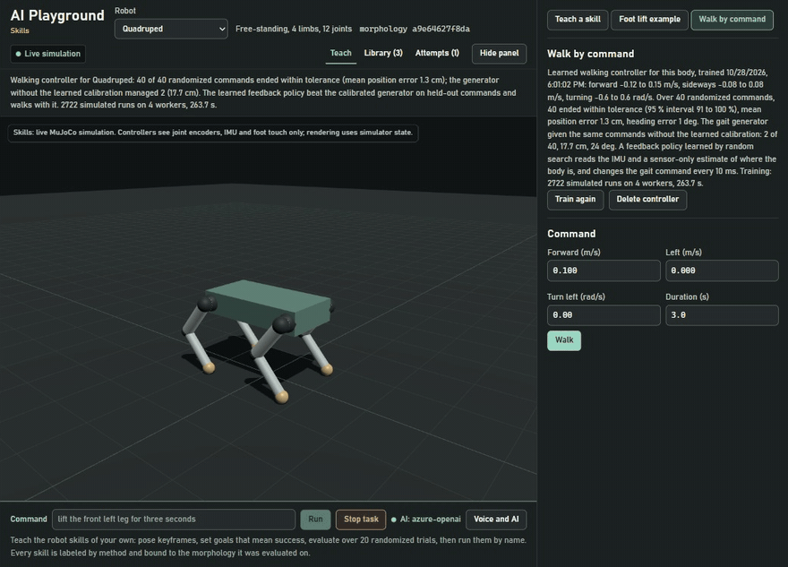
  <br>
  <sub><b>"walk forward 40 centimeters"</b> &rarr; one <code>locomote</code> tool call &rarr; learned walking controller &rarr; measured 0.414 m, error 1.4 cm (simulator ground truth). Real recording with a real model, at real speed.</sub>
</p>

---

## Contents

- [Why MorphLab](#why-morphlab)
- [Tour](#tour)
- [The AI is a closed loop, not a chatbot](#the-ai-is-a-closed-loop-not-a-chatbot)
- [Measured, not claimed](#measured-not-claimed)
- [Architecture](#architecture)
- [Quick start](#quick-start)
- [Testing](#testing)
- [Project layout](#project-layout)
- [Documentation](#documentation)
- [Limitations](#limitations)
- [License](#license)

## Why MorphLab

| | |
|---|---|
| **Zero install** | Kinematics, physics (MuJoCo compiled to WebAssembly), control, sensors, navigation, learning and storage all run in the page. No backend is needed; the AI is optional. |
| **Any body** | Generate quadrupeds, hexapods, octopods, bipeds, arms with up to seven joints, or a rover. Every physical edit creates a new morphology version with a SHA-256 hash. |
| **Skills you can trust** | Every skill is evaluated over 20 randomized trials, reported with a Wilson 95 % interval and bound to the exact morphology it was evaluated on. |
| **Honest labels** | Replay is never shown as learned control, animation never as physics, simulator ground truth never as perception. Every view says which one it is. |
| **AI that measures** | A language model selects tools; it never produces joint targets or torques. Every call is schema-checked, bounded, run by a task manager and answered with measurements. |
| **Stop always works** | The Stop control applies a safe stop locally, without any AI service. |

## Tour

<table>
<tr>
<td width="50%" valign="top">
<h3>Build any body</h3>
<p>Legged and arm generators, a joint editor with limits and effort, mirrored limbs, saved versions and JSON export. Each physical change is a new morphology version.</p>
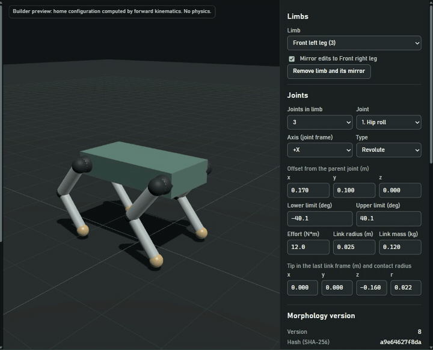
</td>
<td width="50%" valign="top">
<h3>See the kinematics</h3>
<p>Damped least-squares IK with joint limits, coordinate frames, the manipulability ellipsoid, workspace samples, and an honest <i>Unreachable</i> with the distance that remains.</p>
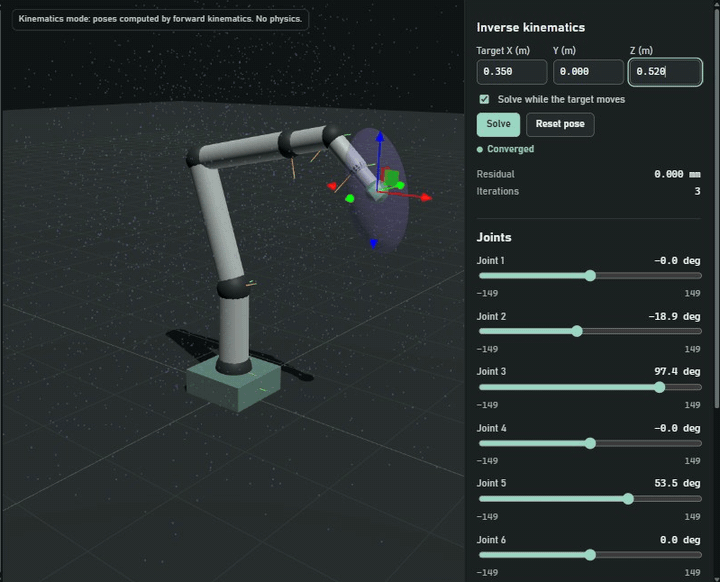
</td>
</tr>
<tr>
<td width="50%" valign="top">
<h3>Simulate real physics</h3>
<p>MuJoCo in WebAssembly with PD control at 500 Hz on encoder readings, effort limits, a push tool, and plots of commanded, measured and applied signals.</p>
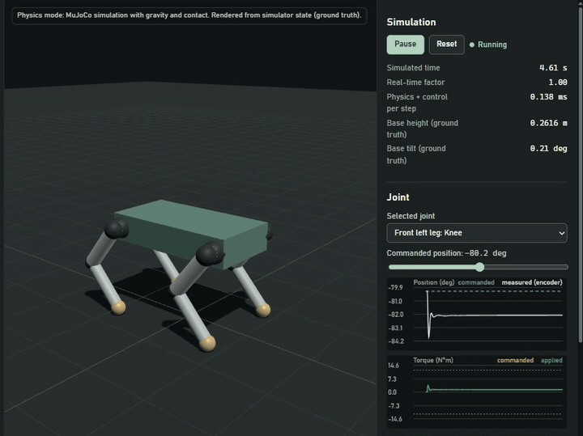
</td>
<td width="50%" valign="top">
<h3>Navigate from sensors</h3>
<p>Sensor-only mode: wheel odometry and IMU, a log-odds occupancy grid from nine range rays, A* planning and pure pursuit. Ground truth is used only by the referee.</p>
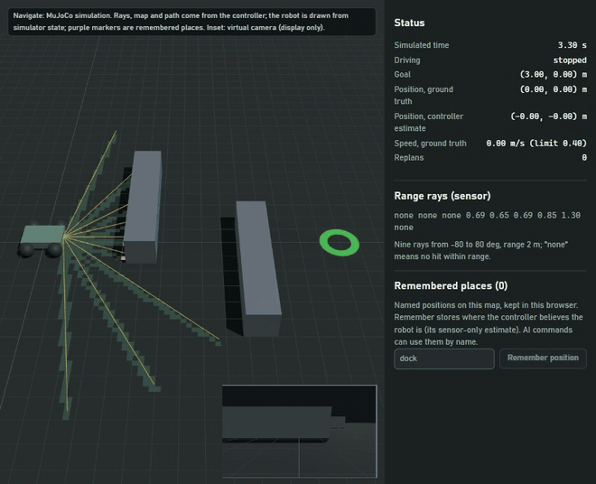
</td>
</tr>
<tr>
<td width="50%" valign="top">
<h3>Teach a skill</h3>
<p>Pose the live robot, keep keyframes, say what success means (tilt, height, lift, travel, turn), try it once, then evaluate it over 20 randomized trials. It then runs by name.</p>
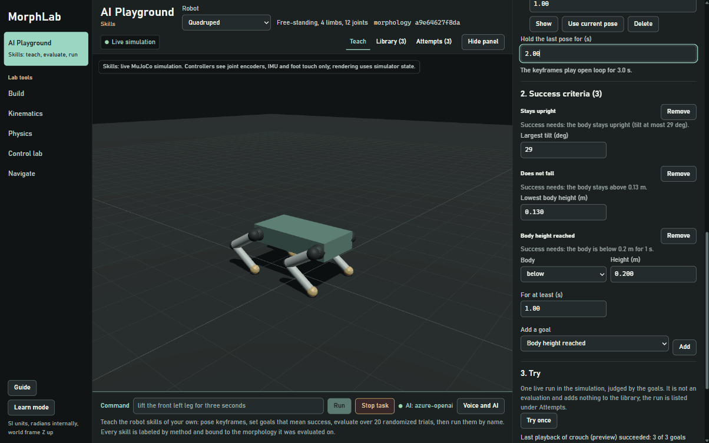
</td>
<td width="50%" valign="top">
<h3>Run it by name</h3>
<p>A local rule parser handles known commands without any AI. Here it picks the best evaluated foot-lift skill and reports the hold it actually measured.</p>
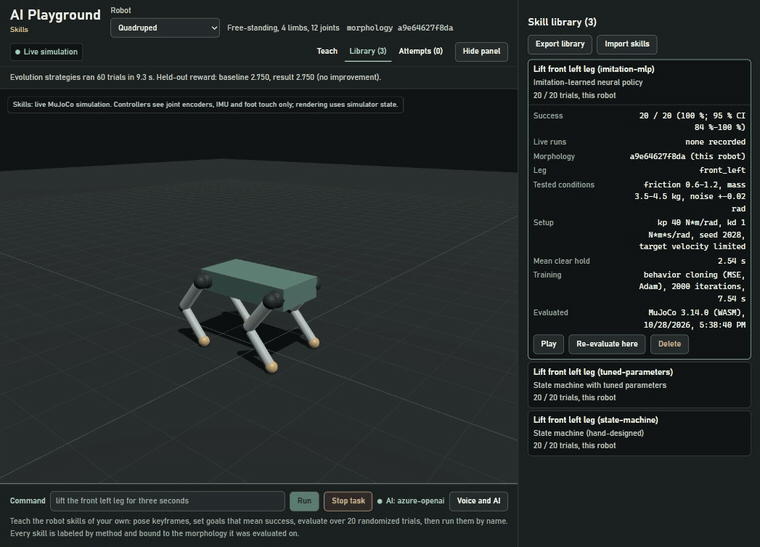
</td>
</tr>
<tr>
<td width="50%" valign="top">
<h3>Tune controllers</h3>
<p>The Control lab runs recorded MuJoCo step tests and compares two gain sets against a second-order linear prediction, with rise time, overshoot, settling and steady-state error.</p>
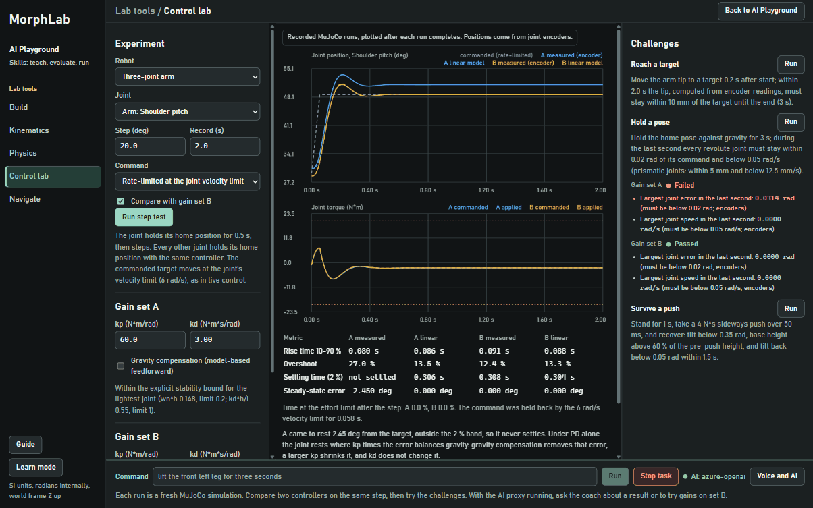
</td>
<td width="50%" valign="top">
<h3>Compare attempts</h3>
<p>Every playback is recorded. Replay two attempts side by side on one timeline with their measured curves (display only: nothing is re-simulated).</p>
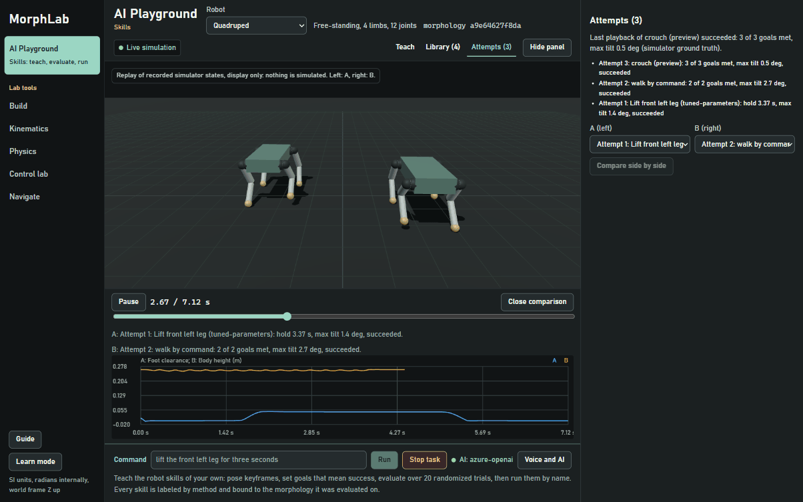
</td>
</tr>
</table>

<details>
<summary><b>More screenshots</b></summary>

| AI Playground and skill library | Kinematics overlays |
|---|---|
| 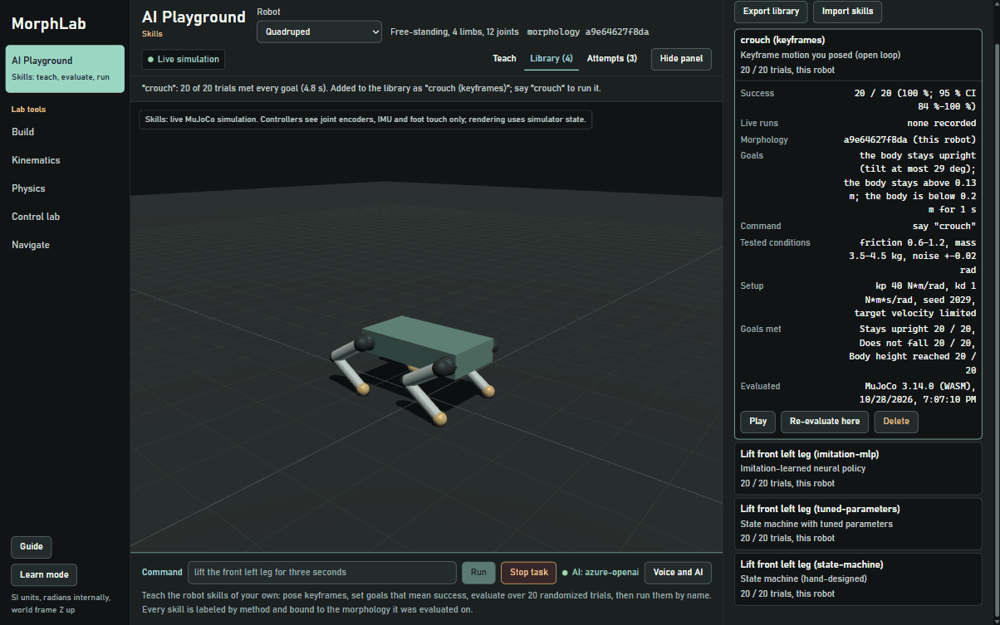 | 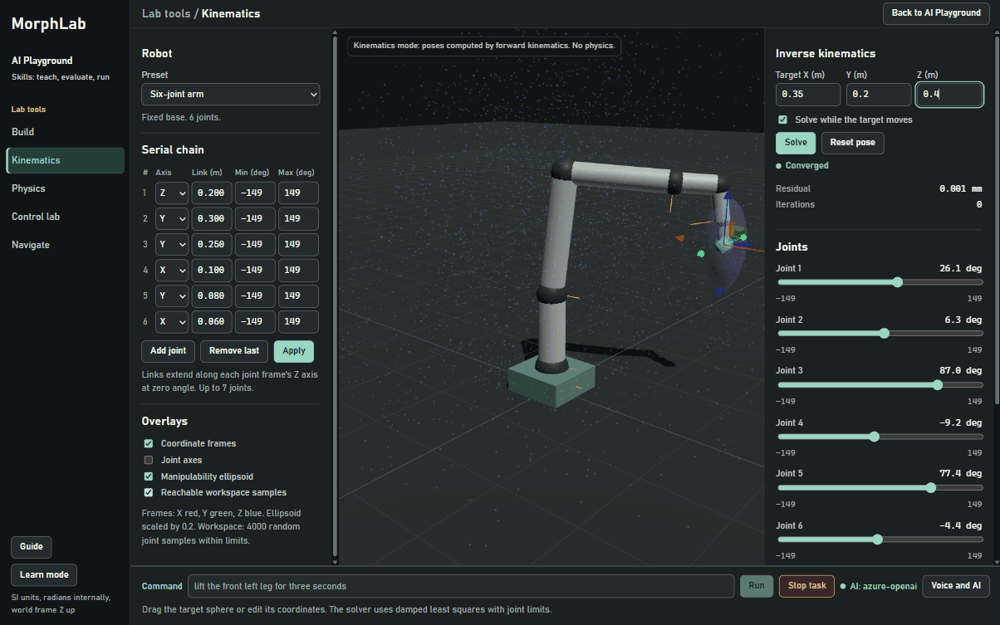 |
| **Robot builder** | **Physics inspector** |
| 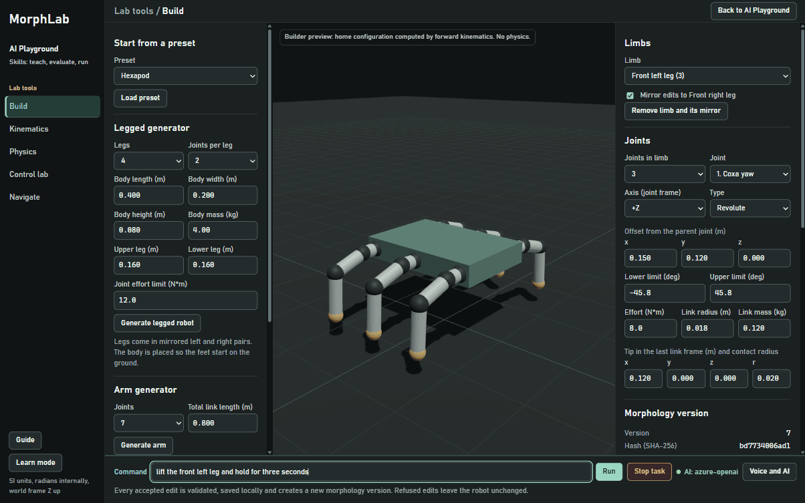 | 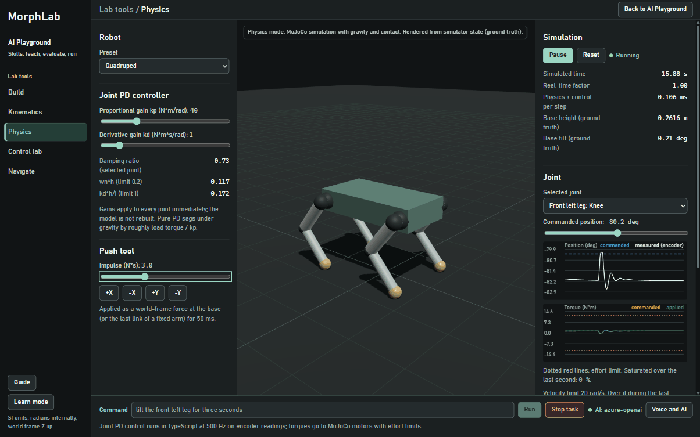 |
| **Navigate** | |
| 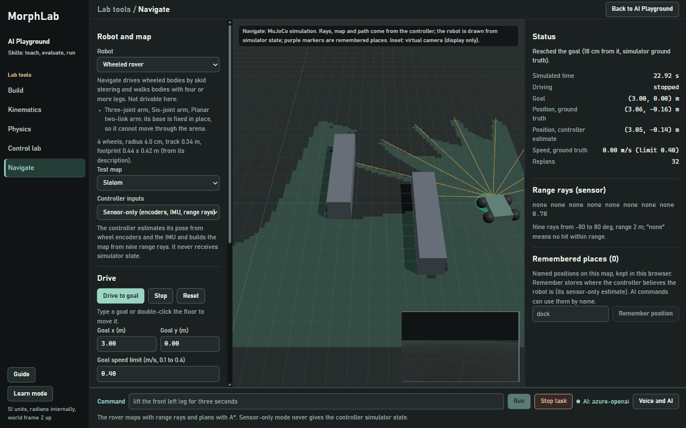 | |

</details>

### Five ways to get one skill

The foot-lift example shows the same task done five ways, each labeled for what it is:

| Method | Label in the app | What it is |
|---|---|---|
| State machine | `state-machine` | Hand-designed: shift weight, lift with leg IK, hold, lower until the touch sensor reports contact |
| Tuned parameters | `tuned-parameters` | The same structure with edited shift, height and timings |
| Demonstration | `replay` | An open-loop recording, labeled as replay, never as learned control |
| Imitation learning | `imitation-mlp` | A 64x64 network trained by behavior cloning in a Web Worker |
| Reward-based improvement | `es-improved` | Evolution strategies starting from the tuned parameters, kept only if held-out reward improves |

Beyond the example: taught keyframe skills, AI-composed skills, gaits with learned feedback policies (augmented random search), a per-body learned walking controller, and mirror images of skills checked against the body's symmetry.

## The AI is a closed loop, not a chatbot

<p align="center">
  
</p>

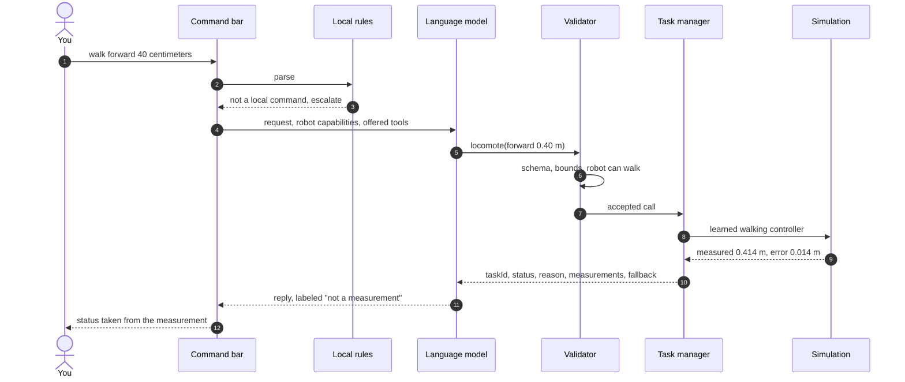

- **Thirty tools**, offered only when the current robot and view support them.
- **Every argument is validated** against a Zod schema and the robot's limits before anything runs; refusals come back with a reason.
- **One task at a time.** A new task cancels the old one, plans made against an older state are refused, and Stop applies the body's safe stop.
- **The model never claims success.** The status line comes from the measured result; the model's prose is shown separately and labeled.
- **Secrets stay on the server.** The local proxy (Node.js, or PowerShell for machines without Node.js) is the only reader of `.env`, listens on loopback, checks host, origin and session, rate-limits, allowlists tool names and never sends images.

## Measured, not claimed

<p align="center">
  
</p>

Every number above was read from the app during the recording session for this README; the full list and the conditions are in [docs/status.md](docs/status.md). Failures are reported the same way: a 6 N*s push tips the quadruped over, and evolution strategies that find nothing better say so.

## Architecture

<p align="center">
  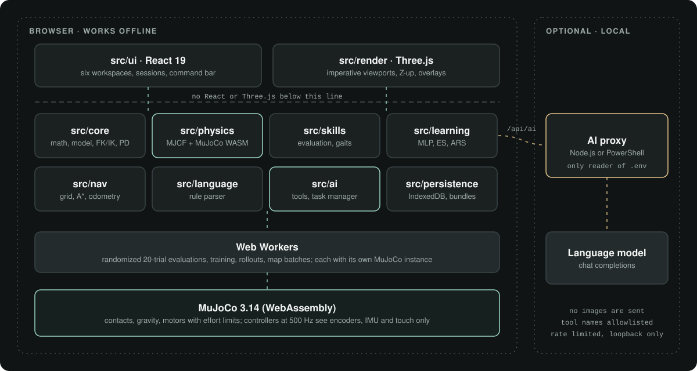
</p>

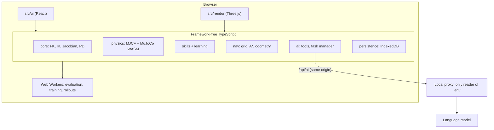

Conventions: SI units and radians inside; a right-handed, Z-up world frame shared by physics and rendering (no axis swap); 4x4 column-major transforms where `T_a_b` maps frame b into frame a; MuJoCo quaternion order `[w, x, y, z]` inside the core, converted only at the Three.js boundary. Details in [docs/architecture.md](docs/architecture.md).

## Quick start

### Requirements

- To use the app: a current Chrome, Edge or Firefox with WebAssembly and WebGL2, and a keyboard.
- To build and test: Node.js 22.18 or newer (CI uses Node.js 24).
- Optional: an Azure OpenAI chat completions deployment for the AI features.
- Optional: Python 3.10+ to regenerate the ModernRobotics oracle fixtures (`tools/oracle`).

### Run it

```bash
npm ci
npm run dev          # app on http://localhost:5173, AI proxy on 127.0.0.1:8787
```

Without `.env` everything except the AI works, and the command bar says so. To enable the AI:

```bash
cp .env.example .env # then set API_KEY and ENDPOINT
```

`ENDPOINT` is an Azure OpenAI chat completions URL
(`https://<resource>.openai.azure.com/openai/deployments/<deployment>/chat/completions?api-version=...`).
The proxy stops at start with a message naming the variable if one is missing or malformed. `.env` is git-ignored and never reaches the browser, the bundle or storage.

| Command | Purpose |
|---|---|
| `npm run dev` | Development server and AI proxy together; the app keeps running if the proxy cannot start |
| `npm run dev:web` | Development server only (AI shows as unavailable) |
| `npm run build` | Type check and static production build in `dist/` |
| `npm run serve:dist` | Serve `dist/` under a sub-path with a strict Content Security Policy |
| `npm run typecheck` | Strict type check of the app and the proxy |
| `npm test` | Unit and integration tests (Vitest, headless MuJoCo) |
| `npm run spikes` | Phase 1 feasibility spikes |
| `npm run test:e2e` | Playwright suites (needs matching Chromium and Firefox builds) |

### Run without Node.js

`server/serve.ps1` (PowerShell 7.3+, nothing else) serves a production build and the same AI routes, with the same checks and limits as the Node.js proxy, on one local origin:

```powershell
pwsh -NoProfile -File server/serve.ps1          # http://127.0.0.1:4173/ ; -Port, -Root and -EnvFile are optional
pwsh -NoProfile -File server/serve.tests.ps1    # offline checks of the guards and mappings
```

Build `dist/` anywhere Node.js is available (for example in CI) and copy it next to `server/`.

### Host it

`dist/` is static and works from any path. A host must serve `.wasm` as `application/wasm`, and a Content Security Policy, if any, must allow `script-src 'self' 'unsafe-eval' 'wasm-unsafe-eval'` and `worker-src 'self'` (the MuJoCo glue uses `new Function`). A static host has no proxy, so the AI features show as unavailable there.

This repository includes [`.github/workflows/pages.yml`](.github/workflows/pages.yml): enable **Settings > Pages > Source: GitHub Actions**, then run **Deploy demo to GitHub Pages** from the Actions tab to publish your own demo.

## Testing

| Layer | What is checked | How |
|---|---|---|
| Math and kinematics | FK and Jacobians against ModernRobotics fixtures (39 cases, to 1e-9), closed-form 2R and 3R solutions (1e-12), finite differences | Vitest |
| Physics | MuJoCo's own kinematics agrees with the core to 1e-9 on five robot types; collisions; presets stand; step responses | Vitest with headless MuJoCo WASM |
| Control | Step metrics against analytical second-order responses; saturation and rate limits | Vitest |
| Skills and learning | Evaluation harness, imitation, ES, ARS, gaits, mirroring, walking controller, artifact validation | Vitest |
| AI and server | Tool schemas, task manager, AI loop with scripted models, proxy guards and limits, PowerShell parity | Vitest, `server/serve.tests.ps1` |
| Feasibility | Six gated spikes: physics, dynamic morphology, IK, learning, skills, language | `npm run spikes` |
| Browser | Builder, kinematics, physics, control, navigation, skills, persistence, accessibility, performance budget | Playwright |

On this source, the type check, the build, **556 unit tests in 59 files** and **24 spike tests in 17 files** passed in CI. The workflow in this repository runs the same commands on every push.

## Project layout

```text
src/
  core/         math, robot model and builder, FK/IK/Jacobian, PD control, step metrics
  physics/      MJCF generation, MuJoCo runtime, experiments, navigation runs
  skills/       evaluation, taught skills, gaits, locomotion, mirroring, workers
  learning/     MLP, evolution strategies, augmented random search
  nav/          occupancy grid, A*, odometry, pure pursuit, referee, legged driver
  language/     rule-based command parser and resolver
  ai/           tool schemas, task manager, AI loop, memory, proxy protocol
  persistence/  IndexedDB store, bundle import and export
  render/       Three.js viewports and overlays
  ui/           React workspaces, sessions, command bar, plots, theme
server/         local AI proxy: Fastify (Node.js) and serve.ps1 (PowerShell)
tests/          unit, integration and Playwright suites; oracle fixtures
spikes/         Phase 1 feasibility spikes
tools/oracle/   ModernRobotics fixture generator (Python)
docs/           vision, architecture, decisions, status, UI and interface guides
```

## Documentation

| Document | Contents |
|---|---|
| [vision.md](docs/vision.md) | Goals and boundaries (not a feature list) |
| [status.md](docs/status.md) | What is implemented and verified, measured results, known limitations |
| [architecture.md](docs/architecture.md) | Layers, frames, schemas, data flow, AI layer |
| [decisions.md](docs/decisions.md) | Technology decisions with evidence and rejected alternatives |
| [milestones.md](docs/milestones.md) | Spikes, milestones and acceptance criteria |
| [ui.md](docs/ui.md), [interface.md](docs/interface.md), [layout.md](docs/layout.md) | UI stack, interaction contract, screen layout |
| [ai-command-testing.md](docs/ai-command-testing.md) | Audit of the AI tool paths with a real model |
| [physical-ai-plan.md](docs/physical-ai-plan.md), [physical-ai-analysis.md](docs/physical-ai-analysis.md), [research-paths.md](docs/research-paths.md) | Learning roadmap, analysis and research notes |

## Limitations

- Simulation only. Simulated sensors are idealized, and nothing here is claimed to transfer to hardware.
- Balancing on two legs is not solved; taught keyframe skills are open loop unless a feedback policy is trained for them.
- IK is position-only. Odometry is not corrected by the map. Evaluations randomize friction, mass and joint offsets, not terrain or latency.
- The only supported language model provider is an Azure OpenAI chat completions deployment; replies are not streamed and no images are sent.
- The full list is in [docs/status.md](docs/status.md#known-limitations).

## License

[MIT](LICENSE). MuJoCo, Three.js, React and the other dependencies are used under their own licenses through npm.
