# Physical-AI plan: learned controllers in the joints

Status of every item below is tracked in `docs/status.md`; this file is the
plan and the research it rests on (2026-10-06). Nothing here is implemented
until `docs/status.md` says so.

Execution update, 2026-10-14 (D33): the user has clarified that training
compute means the laptop's built-in GPU, not an external training service.
Keep execution and this first learning slice browser-local. The current
browser exposes Intel gen-12lp through WebGPU, but existing MuJoCo rollouts
are CPU work. An opt-in small nonlinear ARS policy and paired sensor
ablation are the next bounded experiment; this is not PPO or GPU training.
Tier C import remains a future option, not an approved remote job.

## 1. What "physical AI" means here
A learned network decides the joint targets at every control step, from the
robot's own sensors, and the language model decides what the robot should
do. Concretely:
- A policy `pi(observation, command) -> action` runs in the control loop at
  100 Hz (MorphLab's control rate) and its action becomes joint position
  targets for the existing PD loop. It is trained in simulation by
  reinforcement learning or random search, not written by hand.
- The language model never produces joint targets or torques (project
  rule; also a latency fact: our measured model calls take 1 to 3 s). It
  selects tools: it sets commands (speed, turn, gait), asks for a policy to
  be trained against bounded reward terms, and reads measured results.
- Every learned controller is evaluated over randomized trials, labeled
  `learned`, bound to a morphology hash, and the local Stop always works.

Not physical AI in this sense: replaying keyframes, a hand-designed gait,
or a language model emitting joint values.

## 2. Research (read at code level where code exists)
| Source | What it shows (verified) | What MorphLab takes |
|---|---|---|
| legged_gym, ETH (code: `legged_robot.py`, `legged_robot_config.py`, BSD-3-Clause) | Observation: base linear velocity, angular velocity, projected gravity, commands, joint positions minus default, joint velocities, last action. Action: target = default + 0.5 x action into a PD loop, policy at 50 Hz (decimation 4 at 5 ms). Rewards: exp(-error^2/0.25) velocity and yaw tracking, penalties on vertical speed, roll and pitch rates, torques, joint acceleration, action rate, feet air time; friction 0.5 to 1.25 and pushes randomized. PPO 1500 iterations x 4096 robots x 24 steps (about 1.5e8 steps). | Observation and reward structure, randomization, termination on falls. Not the sample budget (Section 4). |
| MuJoCo Playground Go1 joystick (code: `joystick.py`, Apache-2.0); Zakka et al. 2025, arXiv 2502.08844 | MuJoCo-based: control 0.02 s, physics 0.004 s, Kp 35, Kd 0.5, action scale 0.5. 48 sensor observations (noisy linear velocity, gyro, gravity, joint angles and velocities, last action, command); a privileged state for the critic. Reward scales for tracking (1.0, 0.5), orientation (-5), action rate (-0.01), energy, foot slip, clearance, air time; reward clipped at 0; termination when the up vector points down. Policies train in minutes on one GPU and transfer to real robots. | The closest reference for a MuJoCo setup; reward terms and scales; the Tier C training path (Phase 6). |
| Rudin et al. 2021, arXiv 2109.11978 | Thousands of parallel robots on one GPU: flat-ground walking in under four minutes, rough terrain in twenty; transferred to ANYmal. | Shows why from-scratch PPO belongs on a GPU, not in a browser worker. |
| PMTG, Iscen et al. 2018, arXiv 1910.02812 | A linear policy modulating a parametric gait trajectory generator learns speed-controlled walking from 4-D IMU observations in under 1000 rollouts (ES or deep RL) and runs on a real robot. | Phase 1: MorphLab's gait generator is the trajectory generator; a learned linear policy adds joint corrections. |
| ARS, Mania et al. 2018, arXiv 1803.07055 (code: `ars.py`) | Linear policies trained by random search with antithetic directions, top-b selection, reward normalization by its standard deviation, and running mean-std observation normalization match state-of-the-art sample efficiency on MuJoCo locomotion and are at least 15 times cheaper to compute. | Phase 0 and 1 trainer (ARS V2-t), reimplemented in TypeScript. |
| CleanRL PPO (code: `ppo_continuous_action.py`, MIT) | Single-file PPO: tanh 64x64 actor and critic, state-independent log std, GAE (gamma 0.99, lambda 0.95), clip 0.2, 10 epochs, 32 minibatches, Adam 3e-4 annealed, observation and reward normalization. | Phase 3 reference for a TypeScript PPO on MorphLab's MLP (which already has backpropagation and Adam). |
| RSL-RL (docs and license, BSD-3-Clause) | PPO with an adaptive learning rate from a KL target of 0.01, distillation, symmetry augmentation. | Symmetry is in D26; distillation pattern for Phase 4. |
| Walk These Ways, Margolis and Agrawal 2022, arXiv 2212.03238 | One policy conditioned on gait parameters (frequency, footswing, posture, speed) gives many behaviors without retraining. Needs a GPU with about 10 GB. | Phase 2: condition the learned controller on MorphLab's gait parameters, so the language model picks behaviors at run time. |
| Sim-to-Real, Tan et al. 2018, arXiv 1804.10332 | An open-loop reference plus a learned feedback policy; robustness from randomized physics, perturbations, latency and a compact observation space. | Residual design and randomization list (Phase 1, Phase 7). |
| RMA, Kumar et al. 2021, arXiv 2107.04034 | A base policy plus an adaptation module that infers the environment from recent proprioception; deployed on A1 without fine-tuning. | Phase 7 (history input). |
| Language to Rewards, Yu et al. 2023 (repo, Apache-2.0) | The language model writes reward parameters; MuJoCo MPC optimizes them in real time; 90 % of 17 tasks against 50 % for primitive skills. | The language model sets bounded reward weights, never code (Phases 1 and 5). |
| MuJoCo MPC, Howell et al. 2022, arXiv 2212.00541 | Predictive Sampling, a derivative-free planner, is competitive with iLQG and gradient descent. | Phase 5: a sampling planner over MuJoCo WASM rollouts in a planning mode. |
| Prompt2Walk, Wang et al. 2024, arXiv 2309.09969 | A language model prompted with physical data produced low-level walking commands in simulation. | Not adopted: a research demo; latency and cost rule it out for a 100 Hz loop. |
| pi0, Black et al. 2024, arXiv 2410.24164 | A vision-language-action flow model on a pretrained VLM, trained on multi-robot data. | Not adopted: needs GPUs and datasets (Tier C). |
| ONNX Runtime Web (docs) | `onnxruntime-web` runs ONNX models in the browser on WebAssembly (all operators), WebGPU or WebNN. On-device training needs artifacts generated in Python. | Phase 6 import path for policies trained elsewhere. |
| MuJoCo WASM (official bindings; zalo/mujoco_wasm demos, MIT) | `MjModel`, `MjData`, `mj_step`, `mj_forward`, typed-array state, `.delete()`. | Already used; several `MjData` per model allow planner rollouts (Phase 5). |

The nine repositories reviewed for D26 (MimicKit, TD-MPC2, DreamerV3,
Diffusion Policy, ACT, robomimic, rlkit, BeyondMimic, RSL-RL) are in
`docs/research-paths.md`.

## 3. MorphLab today (read from the code)
- Control: `runSkillTrial` and the live `PhysicsSession` call a
  `SkillController.update(t, obs)` every 5 physics steps (100 Hz at 2 ms).
  Targets pass a `TargetRateLimiter` and `pdControl` (default kp 40, kd 1,
  effort limits) into motor actuators.
- Sensors (`SensorReadings`): joint positions `q`, joint velocities `qd`,
  IMU quaternion, gyro, accelerometer, foot touch. Controllers receive only
  `q`, `touch` and `imuQuat` today; a learned controller needs `qd` and
  `gyro` too (an additive change).
- Ground truth for rewards and referees: base pose, linear velocity, tilt,
  limb tips (`judgeSample`, `groundTruthBaseState`); never given to
  controllers.
- Learning code: `Mlp` (tanh, backward pass), `Adam`, ES with antithetic
  pairs and centred ranks (`src/learning`); behavior cloning of the foot
  lift (19/20); ES on taught skills (`improve-taught`, 96 runs).
- One Web Worker per job; no worker pool, no ONNX runtime.
- Throughput, estimated from logged wall times: an improvement of 96 runs
  of about 3.5 s simulated took 14.5 s, and 20 evaluation trials of about
  5 s took 2.2 to 3.5 s, so roughly 12,000 to 16,000 physics steps per
  second in one worker (2,400 to 3,200 control steps). Phase 0 measures it.

## 4. Feasibility (why this order)
| Approach | Samples | Time in one worker at 15,000 physics steps/s | Verdict |
|---|---|---|---|
| PPO from scratch at legged_gym scale | 1.5e8 control steps = 7.4e8 physics steps | about 14 h (about 2 h on 8 workers) | Not in the browser; Tier C (Phase 6) |
| ARS linear policy from scratch | 1e6 to 1e7 control steps | 6 min to over 1 h | Later, with a worker pool |
| PMTG: linear residual over the gait generator | under 1000 rollouts of about 4 s = 2e6 physics steps | about 2 to 3 min | Phase 1 |
| Small PPO residual (CleanRL scale) | about 1e6 control steps | about 6 min plus updates | Phase 3 |
| Predictive sampling planner | 16 rollouts of 0.3 s per 50 ms decision = 2,400 physics steps per decision | about 6 times slower than real time | Phase 5, planning mode only |

## 5. Pipeline structure to build

```mermaid
flowchart LR
  U[User: text or voice] --> L[Language model: chooses tools]
  L -->|commands, bounded reward weights| T[Task manager and tools]
  T -->|train| W[Worker pool: rollouts in MuJoCo WASM]
  W -->|returns, reward terms| A[Trainer: ARS now, PPO later]
  A -->|policy| H[Held-out check vs baseline]
  H -->|kept only if better| E[Evaluation: 20 randomized trials, goals]
  E --> S[Library: policy bound to morphology hash, labeled learned]
  T -->|run| C[Controller at 100 Hz: gait generator plus learned policy]
  S --> C
  C -->|joint targets| P[PD loop and MuJoCo physics]
  P -->|sensors only| C
  P -->|ground truth| R[Referee: measured result]
  R --> L
```

Contracts (versioned, validated at the boundary, NaN-rejecting), as built in
Phase 1 (D27):
- Observation v1 (sensor-only, per control step, 12 values): gravity
  direction x and y in the body frame from the IMU (2), gyro (3), the gait
  phase as sine and cosine of the phase and of twice the phase (4), and the
  gait's commanded forward, sideways and yaw speed (3). Normalized by the
  running mean and standard deviation (floor 0.01) stored with the policy.
  The plan had joint positions minus the generator's targets, joint
  velocities and the previous action as well; v1 leaves them out so the
  linear policy has 13 parameters per joint (PMTG used a 4-D IMU
  observation). Joint velocities and the gyro now reach every controller,
  so a later version can add them.
- Action v1: residual joint offsets, `a` clipped to [-1, 1], scaled by
  0.15 rad and by the gait's fade-in and fade-out envelope, added to the
  generator's targets, clamped to joint limits. A zero policy reproduces the
  hand-designed gait exactly (tested, also in MuJoCo).
- Policy JSON (inside the skill artifact, which carries the morphology
  hash, the observation and action specs and the training record): layer
  sizes [12, joints], weights and biases, input mean and standard deviation.
- Reward spec (for the language model later): named terms with bounded
  weights only; no code.

## 6. Phases
Each phase ends with CI passing, a headless MuJoCo test with measured
numbers, a browser check with the real model where the AI is involved, and
an update of `docs/status.md`.

### Phase 0: measure and build the trainer core
1. Spike `spikes/skill/throughput.spike.test.ts`: physics steps per second
   of gait rollouts on the quadruped and hexapod, with and without the
   controller, printed in the CI log.
2. `src/learning/ars.ts`: ARS V2-t (antithetic directions, top-b, reward
   standard-deviation normalization, running mean-std observation filter,
   deterministic seeds), framework-free.
3. Tests: ARS reduces the cost of a linear-quadratic regulator to near the
   Riccati optimum (closed form); the running filter matches batch mean and
   variance; serialization round trip.
Acceptance: tests pass in CI; throughput number recorded.

### Phase 1: a learned feedback policy in the joints of a gait (PMTG)
1. Observations: pass `qd` and `gyro` to controllers (training and live).
2. `src/skills/policyGait.ts`: `LearnedGaitController` = `GaitController`
   targets plus a linear policy's residual (Observation v1, Action v1),
   with NaN and limit guards; falls back to the generator alone when the
   policy output is not finite, and says so.
3. `src/skills/train.ts`: rollouts under randomized friction, mass and
   joint offsets with a dense reward from ground truth (as built: velocity
   tracking exp(-e^2/0.01) for forward and sideways speed and
   0.5 exp(-e^2/0.05) for the yaw rate, faded like the gait, toward the
   gait's own measured speed along the directions it commands and zero
   along the others; penalties 2 (g_x^2 + g_y^2), 0.5 v_z^2 and 0.01 per
   squared action change; a fall ends the run with -2; plus twice the
   skill's goal reward); ARS updates (30 iterations of 8 directions, top
   4); held-out comparison with the generator alone on 8 trials; kept only
   when the held-out return is higher with no more falls, no fewer trials
   meeting every goal and no lower goal reward (tolerance 0.01). The first
   version followed the nominal command (stride per cycle over the cycle
   time) and, in the browser, halved the travel of a hexapod side step
   whose goal had been tuned to the gait's real speed; hence the measured
   target and the goal terms.
4. Worker job `train-gait-policy` with progress and cancel; artifact method
   `gait-learned`, labeled "Gait with a learned feedback policy (random
   search, closed loop)", morphology-bound, with the training record.
5. Teach panel button "Train a learned feedback policy" for gait drafts;
   AI tool `trainGaitPolicy`; the result goes through `evaluateSkillDraft`.
6. Tests: a zero policy reproduces the gait exactly; on the quadruped side
   step (seeded), training lowers held-out drift and raises the tracking
   reward over the generator alone (numbers reported, not assumed).
Acceptance: measured improvement over the generator alone on held-out
trials, or an honest report that it did not improve.
Status: built (D27); measured in CI on three gaits and checked in the
browser with the real model. Numbers and limits are in `docs/status.md`.

### Phase 2: one command-conditioned locomotion controller per body
Train over command ranges (forward, sideways, turn) with the generator
driven by the command, store it once per morphology, and add a `locomote`
tool: the language model sets speeds for a duration; the learned controller
moves the joints; the referee reports distance, heading and tilt. Worker
pool across `navigator.hardwareConcurrency - 1` workers (at most 4).
Status: built (D28). As built, a learned calibration from the speed asked
for to the generator's command (least squares on 18 measured runs) sits
under the D27 feedback policy, which is trained by batched ARS over random
commands and kept only if it beats the calibrated generator on held-out
commands without ending further from where they lead; `locomote` also
takes a target endpoint and picks the speeds and the duration. Measured:
the calibration raised the evaluation from 2 to 7 of 20 commands on the
quadruped and from 0 to 20 on the hexapod; the policy was rejected on
both (it cannot see heading or position). Numbers and limits are in
`docs/status.md`. Next within this phase: Observation v2 (heading and
position error) and interaction terms in the calibration.
Update (D29): Observation v2 is built. The policy reads a sensor-only
estimate of position and heading (leg odometry and the IMU, within 0.018
m of ground truth) against where the command leads and changes the
generator's stride, side step and turn; on the quadruped it is kept and
raises the evaluation from 19 to 40 of 40 commands (0.058 to 0.013 m). On
the hexapod the calibrated generator is already within 4 mm and the policy
is rejected. Interaction terms in the calibration remain open.

### Phase 3: PPO in TypeScript
Gaussian MLP policy, value network, GAE, clipped objective, Adam, observation
and reward normalization (CleanRL settings), validated on a toy continuous
task with a known solution, then compared with ARS on the Phase 1 task at
equal simulated time.

### Phase 4: closed-loop students of composed skills (distillation)
Turn AI-composed keyframe skills into MLP policies that read proprioception
and a phase clock, trained by DAgger (Ross et al. 2011) against the keyframe
teacher under randomization; arms and legs.

### Phase 5: language-written rewards optimized online (L2R with sampling)
A predictive-sampling planner over MuJoCo WASM rollouts optimizes bounded
reward weights chosen by the language model, in a labeled planning mode
that may run slower than real time.

### Phase 6: Tier C import
Export MJCF and the observation contract; accept ONNX policies trained in
MuJoCo Playground or RSL-RL; run them with `onnxruntime-web` after checking
the contract and the morphology hash; evaluate in MorphLab before use.

### Phase 7: robustness and adaptation
Pushes, motor-strength and latency randomization, observation history
(RMA-style), symmetry augmentation.

## 7. Rules that hold in every phase
- The language model never outputs joint targets, torques or code to run.
- No skill or policy is claimed to work without its evaluation numbers.
- Policies run only on the morphology they were trained on.
- Learned outputs are bounded, clamped and NaN-guarded; Stop always works.
- New dependencies only with verified package names, versions and
  licenses (none planned before Phase 6).

## 8. Risks
- Throughput lower than estimated: reduce rollout length, use fewer
  directions, add the worker pool earlier.
- Reward hacking (fast but unstable gaits): tilt and fall terms, held-out
  check, evaluation with goals before saving.
- Linear policies too weak for some bodies: MLP policies with ARS, then PPO.
- Simulation determinism across platforms: seeded tests with tolerances,
  numbers reported from CI.
